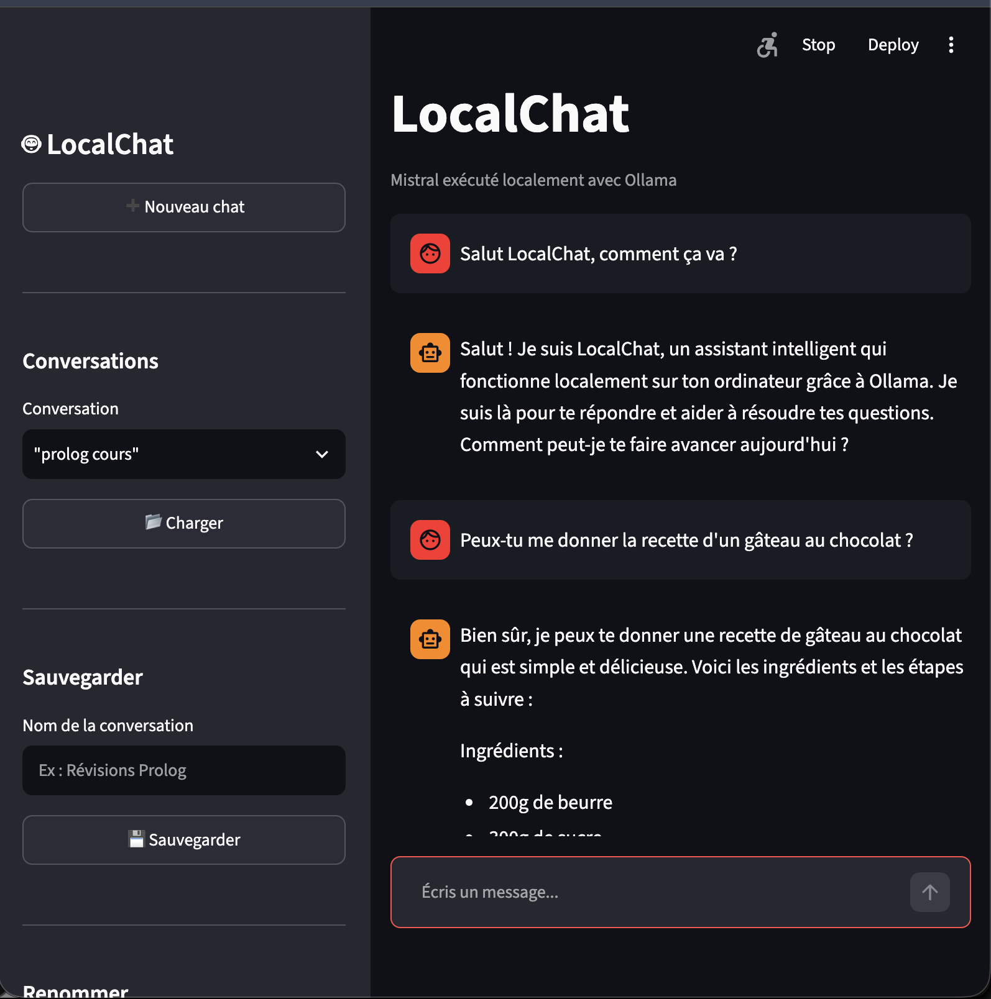

# Local AI Assistant

Assistant IA conversationnel développé en Python,
utilisant Mistral via Ollama.

## Présentation

Ce projet explore l'utilisation de modèles de langage
exécutés localement pour créer un assistant conversationnel.

L'objectif est de développer une application permettant
d'interagir avec un LLM et d'explorer des fonctionnalités
telles que la gestion de conversations et le RAG.

## Technologies

- Python
- Mistral
- Ollama
- Streamlit
- RAG (Retrieval-Augmented Generation)

## Fonctionnalités

- Interaction avec un LLM local
- Interface conversationnelle Streamlit
- Gestion de l'historique des conversations
- Importation et interrogation de documents PDF
- Récupération d'informations documentaires via RAG

## Démonstration



## Installation

### Prérequis

- Python
- Ollama installé et démarré

### Installer les dépendances

```bash
python3 -m venv .venv
source .venv/bin/activate
pip install -r requirements.txt
```

### Télécharger le modèle

```bash
ollama pull mistral
```

### Lancer l'application

```bash
streamlit run app.py
```

## Limites actuelles

- Le modèle doit être installé localement.
- Les performances dépendent du matériel utilisé.
- La qualité des réponses dépend du modèle et des documents.
- Le système peut produire des réponses incorrectes.

## Améliorations envisagées

- Améliorer la recherche documentaire
- Optimiser les performances
- Ajouter des évaluations des réponses générées

## Auteur

Gabriel Imbert
Étudiant en M1 Intelligence Artificielle Distribuée
Université Paris Cité
  